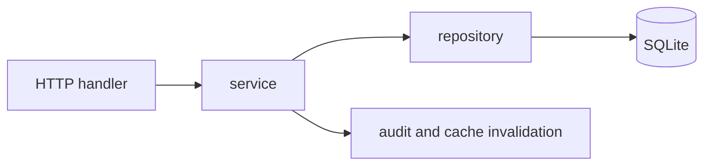

# 后端架构

后端使用 Python 标准库 HTTP 服务和 SQLite。请求处理、业务事务与 SQL 访问保持分层，旧 payload 和历史数据库通过兼容迁移持续可读。

## 分层结构

| 层级            | 主要路径                                               | 责任                                         |
| --------------- | ------------------------------------------------------ | -------------------------------------------- |
| HTTP 与兼容入口 | `server.py`、`server_app/legacy.py`、`server_app/web/` | 鉴权、参数解析、路由、状态码与响应           |
| 业务服务        | `server_app/domains/`；`services/` 为兼容导出          | 校验、跨表事务、审计与缓存失效               |
| 数据访问        | `server_app/repositories/`                             | SQL、分页、索引、结构化热字段与 payload 兼容 |
| 配置与静态资源  | `server_app/config.py`、`server_app/static.py`         | 环境变量、应用、文档和静态文件               |

## 数据库原则

- SQLite 启用 WAL，运行数据默认位于 `data/database/cageledger.sqlite`。
- schema 迁移保持幂等，启动时补充字段、索引和必要回填。
- 列表读取使用服务端分页、筛选与稳定排序；热点字段保存在实体列以避免 JSON 全表扫描。
- 结算、权限、转移和流程推进会写入审计事件。

## 兼容边界

`server_app/legacy.py` 和 `services/` 的兼容导出仍参与装配或历史调用，不能因名称含 legacy 就删除。旧 `/api/reimbursement-ledger/*` 与台账接口仍登记且保留资金、归属和审计规则，当前工作台使用的是 `/api/billing-workflows/*` 登记／补录链路；数据管理仍使用历史台账 Excel 导入。接口的 supported／compatibility 与 UI 可达性分别描述，详见[当前版本与兼容边界](/development/current-baseline)及[接口清单](/development/api-inventory)。

## PDF 与附件

服务端生成 PDF，缓存目录默认位于 `data/cache/pdf/`。巡检和报销附件保存在 `data/files/` 下的受鉴权目录，通过 API 下载。生产镜像预装 Chromium 与中文字体，PDF 任务复用常驻浏览器进程。

接口契约详见 [API 与数据模型](/development/api-and-data-model)。
